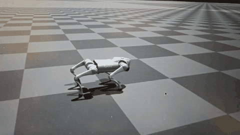

# Pure-Torque Go2 Jumping with Landing-Point Control

A quadruped jump is more than reaching a distance. The robot has to load its legs, push off, fly without ground contact, land near a requested point, absorb the impact, and stand again. I built a command-conditioned single-jump task for the Unitree Go2 around this full sequence: the policy receives a landing-distance command and must complete the jump and recovery.

I trained the controller with PPO in Isaac Gym. Its action directly controls the 12 joint torques, with **no PD torque assistance** (`α_PD = 0`). A phase-dependent posture reference guides the motion through loading, push-off, flight, pre-landing, and recovery; it does not add PD torque to the action. To check performance beyond one fixed setup, I also ran domain-randomized tests with robot mass varied by ±1 kg and ground friction from 0.5 to 1.25.

I wrote more than ten Python tools to make the experiments repeatable and easier to diagnose. They include batch evaluation across jump commands, phase-by-phase motion analysis, joint torque–speed checks, and scans with configurable randomization conditions.

## Results

The strongest landing accuracy was in the 0.80–0.90 m command range. The figures below are from the nominal simulation evaluation with fixed friction and a +0.1 kg base-mass offset. A hit means touchdown within 0.10 m of the target; settling uses the strict post-landing stability criterion.

| Forward jump command | Landing hit rate | Mean landing error | Strict settling |
|---:|---:|---:|---:|
| 0.80 m | 98% | 0.053 m | 100% |
| 0.90 m | 98% | 0.031 m | 100% |

At 1.00 m, the policy still settled in every tested episode, but target accuracy dropped to a 66% hit rate and 0.103 m mean error. This marks the edge of the tested command range rather than the controller's strongest result.

At the 1.00 m command, the recorded **total forward displacement** in the nominal simulation was **1.344 m**, measured from the episode start to touchdown. This includes the robot's movement before take-off. In the separate full domain-randomization evaluation, the measured airborne distance at the same command was **0.872 m**, after **0.417 m** of pre-take-off movement. These figures use different evaluation conditions, so they should be read separately. The 1.00 m command is also less reliable than the 0.80–0.90 m range above.

## Comparison with published quadruped jumps

| Work | Robot and reported forward jump distance |
|---|---|
| This project | Go2, **1.344 m total displacement** in simulation at a 1.00 m command; the full-randomization test measured **0.872 m airborne distance** at that command |
| [Atanassov et al. (2024)](https://arxiv.org/abs/2401.16337) | Quadruped, **0.90 m** forward jump |
| [Olsen et al. (2025)](https://arxiv.org/abs/2510.24584) | Quadruped, **1.25 m** maximum forward jump reported |

These published distances give useful context for the scale of the task. They are not a controlled head-to-head comparison: robot platforms, command definitions, and distance measurements can differ. In this project, the result is from simulation, and the distance from episode start includes the run-up before take-off.

## Demo

  

Click the preview to open the full video.

## Code

The task implementation is in `legged_gym/legged_gym/envs/go2/go2_omnijump_landing_torque/`. Evaluation and analysis utilities are in `legged_gym/legged_gym/scripts/` and `paper_tools/`.

The torque-control base is adapted from SATA; the original research and method are by Li et al., [SATA: Safe and Adaptive Torque-Based Locomotion Policies Inspired by Animal Learning](https://arxiv.org/abs/2502.12674), RSS 2025.
